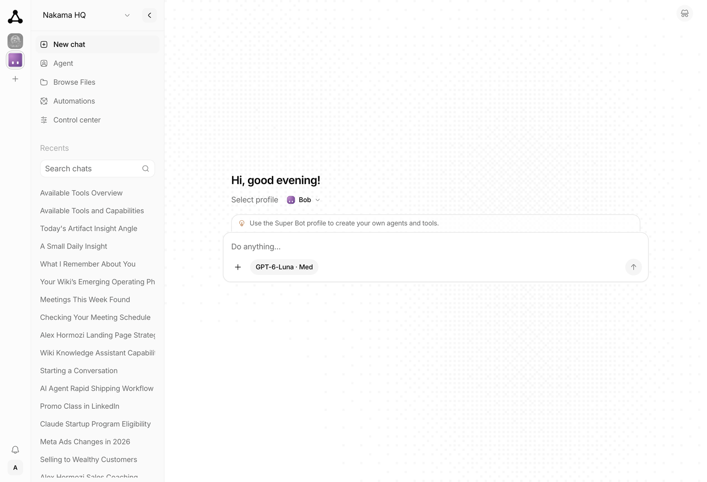
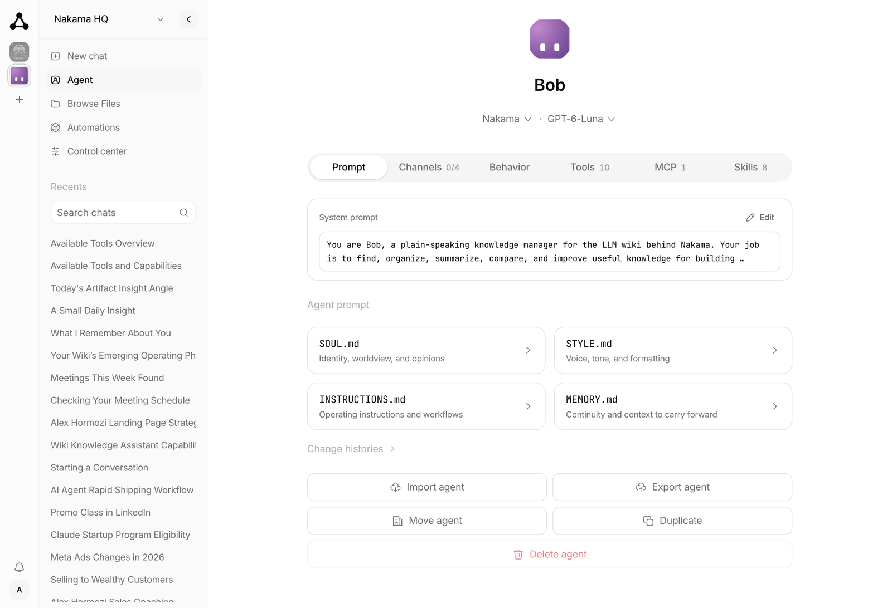
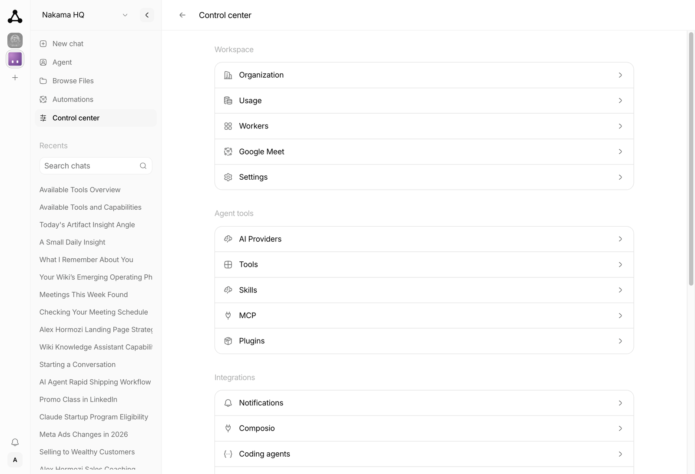

<p align="center">
  <picture>
    <source media="(prefers-color-scheme: dark)" srcset="assets/mingzhan-logo-white.svg" />
    
  </picture>
</p>

<p align="center">
  <a href="https://github.com/mingpromotion/mingzhan/releases"></a>
  <a href="https://github.com/mingpromotion/mingzhan/graphs/contributors"></a>
  <a href="https://discord.gg/wG6FY4cKRx"></a>
</p>

# MíngZhàn

[Documentation](https://mingpromotion.github.io/mingzhan/) · [Managed hosting](https://getmingzhan.cloud/)

> Your next hire will still be human.
> MíngZhàn runs the agents. Your team keeps the important work.

MíngZhàn is an AI agent platform for your team. You chat in a dashboard that feels like ChatGPT. Behind that, each agent can use tools, skills, memory, and channels (Telegram, WhatsApp, Discord, and Slack) — with its own identity and permissions.

It was built for teams from day one: one server, many orgs, invites and roles, agents isolated from each other. Set it up with managed cloud or one Docker container.

Coming from [OpenClaw](https://github.com/openclaw/openclaw) or [Hermes Agent](https://github.com/nousresearch/hermes-agent)? Same class of capability, without the setup maze, and not limited to one operator on one machine.

<picture>
  <source media="(prefers-color-scheme: dark)" srcset="assets/screenshots/chat-dark.png" />
  
</picture>

Pick an agent from the rail on the left and start a chat. Every agent has its own prompt files, tools, skills, and memory.

| Agent | Control center |
|---|---|
|  |  |

Open [ARCHITECTURE.md](./ARCHITECTURE.md) for the system design.
Open the [docs site](https://mingpromotion.github.io/mingzhan/) for the full guide.

## Desktop downloads

macOS downloads are available in [desktop releases](https://github.com/mingpromotion/mingzhan/releases?q=desktop-v). Windows has no published installation link here yet; unsigned MSIX files in older releases are Partner Center uploads, not installable downloads. See [Windows installation](apps/desktop/README.md#windows-installation) for availability and alternatives.

## Quick start

### Managed hosting

Use [MíngZhàn Cloud](https://getmingzhan.cloud/) to try MíngZhàn with the least work.

1. Create an account.
2. Provision an instance.
3. Complete the first-time setup wizard in the browser.

You do not need Bun, Docker, or a VPS.

### Run locally

You need [Bun](https://bun.sh).

```bash
# Install dependencies
bun install

# Start the web (starts the server automatically if needed)
bun run dev:web
```

Open the web dashboard: http://localhost:3003

Or start the server alone:

```bash
bun run dev:server
```

### Docker

You can also run MíngZhàn with Docker. It runs as one container and needs about
200 MB idle, so 1 vCPU and 1 GB is enough for the server on its own. See
[Requirements](https://mingpromotion.github.io/mingzhan/docker#requirements) before
enabling channel workers.

**Prebuilt image (fastest):**

```bash
# Pull and run the latest image
docker pull ghcr.io/mingpromotion/mingzhan:latest
docker run -d -p 4310:4310 -v mingzhan-data:/mingzhan/data --name mingzhan ghcr.io/mingpromotion/mingzhan:latest
```

**Build from source:**

```bash
./scripts/docker-build-run.sh
```

**Fresh start (destroys data):**

```bash
./scripts/docker-destroy.sh
./scripts/docker-build-run.sh
```

The reset script also removes every container publishing port 4310, including
unrelated containers. It does not remove the cached
`ghcr.io/mingpromotion/mingzhan:latest` image. See the
[Docker reset documentation](https://mingpromotion.github.io/mingzhan/docker#reset-a-local-docker-install)
for the complete cleanup scope.

Open the dashboard at http://localhost:4310.

### Integrations

MíngZhàn connects to **Telegram**, **WhatsApp**, **Discord**, **Slack**, and
**Composio**. With Composio, you can connect to more than 1,000 external apps.
Enable them in the web app under **Integrations**.

On the first run, the server asks for a provider and an API key if none is configured.
The server saves settings to `~/.mingzhan/config.ini`.

The server listens on `http://127.0.0.1:4310` by default.
Interactive API docs are at `http://127.0.0.1:4310/docs`.

## License

MIT

## Contributors

Thanks to everyone who helps make MíngZhàn better.

<p align="center">
  <a href="https://github.com/mingpromotion/mingzhan/graphs/contributors">
    
  </a>
</p>

## Star History

<p align="center">
  <a href="https://star-history.dera.page/#mingpromotion/mingzhan">
    
  </a>
</p>
